<div align="center">

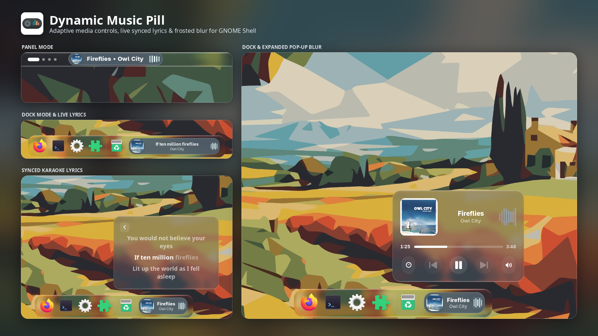

# Dynamic Music Pill

**Adaptive media controller, real-time Cava visualizer, and synchronized karaoke lyrics for GNOME Shell.**

<p align="center">
  <a href="https://extensions.gnome.org/extension/9334/dynamic-music-pill/">
    
  </a>
</p>

[](https://extensions.gnome.org/extension/9334/dynamic-music-pill/)
[](https://extensions.gnome.org/extension/9334/dynamic-music-pill/)
[](https://hosted.weblate.org/engage/dynamic-music-pill/)
[](https://github.com/Andbal23/dynamic-music-pill/stargazers)
[](LICENSE)

</div>

<div align="center">
<table>
  <tr>
    <td align="center">
      <a href="https://extensions.gnome.org/extension/9334/dynamic-music-pill/"></a>
      &nbsp;&nbsp;×&nbsp;&nbsp;
      <a href="https://extensions.gnome.org/extension/10448/simple-taskbar/"></a>
      <p>
        Works smoothest with <a href="https://github.com/Sultech/simple-taskbar"><b>Simple Taskbar</b></a> — dynamic pill width transitions glide cleanly inside Simple Taskbar's Dock and Taskbar modes without layout jumps.
      </p>
      <p>
        <a href="https://extensions.gnome.org/extension/10448/simple-taskbar/"></a>
        <a href="https://github.com/Sultech/simple-taskbar"></a>
      </p>
    </td>
  </tr>
</table>
</div>

---

## Live Preview

<div align="center">
  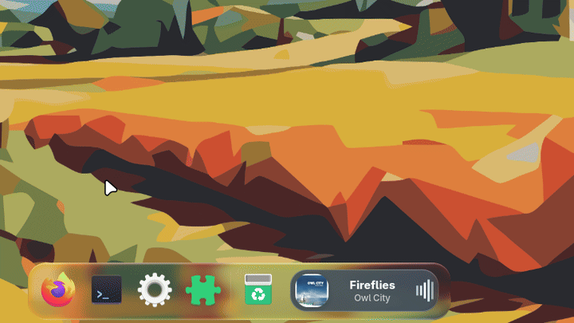
  <br>
  <sub>Real GNOME 51 capture featuring <b>Dash to Dock</b>, <b>Blur my Shell</b> refraction, live <b>Cava</b> spectrum bars, word-by-word karaoke lyrics, and quick subpages — <a href="screenshots/demo.mp4">download crisp MP4</a>.</sub>
</div>

---

## Visual Modes & Placement

Dynamic Music Pill fits naturally anywhere in GNOME Shell — inside your **Dock** (**Dash to Dock**, **Ubuntu Dock**, **Simple Taskbar**) or in any **Top Panel** zone (**Left**, **Center**, **Right**) with independent width, height, margin, and offset profiles.

<p align="center">
  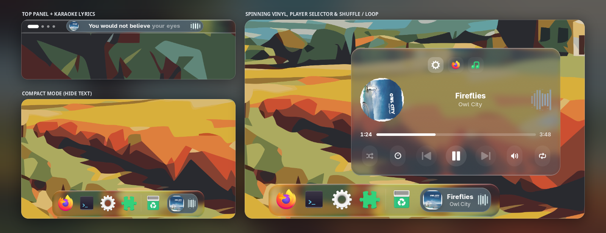
</p>

- **Adaptive Color Engine & Dynamic Contrast** — Automatically extracts the dominant palette from the playing track's cover art and adapts text and icons cleanly on both bright and dark covers.
- **Native Blur Integration (`Blur my Shell v76+`)** — Real-time Dual Kawase and Liquid refraction behind both the main pill and expanded pop-up, with optional album-art color tinting and pipeline following.
- **Four Visualizer Engines** — Choose **Off**, **Wave**, **Beat**, or **Real-Time** (powered by `cava`) with independently configurable bar counts, thickness, height, and margins.
- **Compact & Always-On Modes** — Collapse down to a minimal cover + visualizer pill, or retain your last played track on startup with one-click quick launch.
- **Spinning Vinyl & Multi-Player Selector** — Switch between square album art or a smoothly spinning vinyl disc, and jump between active MPRIS players right from the top of the pop-up.

---

## Expanded Pop-up & Custom Control Buttons

Beyond Play/Pause, Next, Previous, Seek Bar, Shuffle, and Repeat, the pop-up includes **two customizable quick-action button slots** that open sleek frosted subpages directly inside the pop-up — no switching windows required.

<p align="center">
  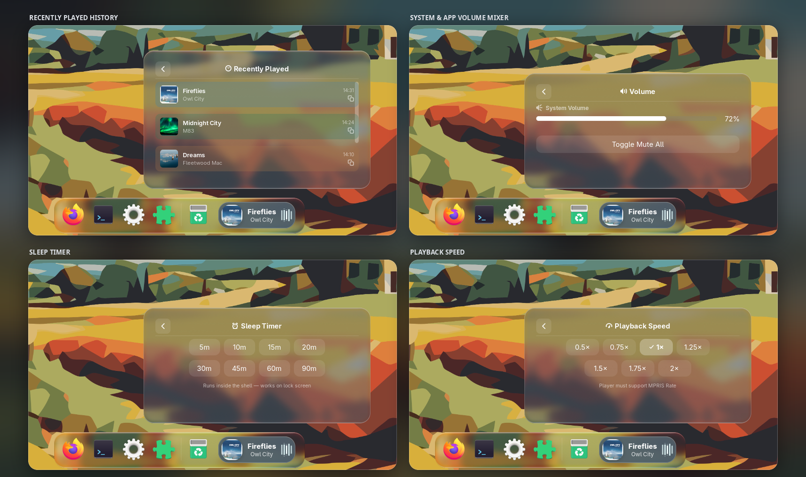
</p>

- **Recently Played History** — Browse recent tracks with cover art, dominant color tinting, timestamps, and one-click copy.
- **System & App Volume Mixer** — Adjust master volume and per-player audio streams via PipeWire/PulseAudio, plus quick mute.
- **Audio Output Switcher** — Switch seamlessly between speakers, DACs, and Bluetooth headphones in place.
- **Sleep Timer** — Built-in shell countdown presets (`5m` – `90m`) that keep running even when the screen locks.
- **Playback Speed Control** — Adjust playback rate (`0.5×` – `2.0×`) for compatible MPRIS players (e.g. podcasts or browsers).
- **Quick Seek Step** — Optional fast skip backward/forward action slot can also be assigned to either custom button.

---

## Synchronized Karaoke Lyrics

- **Word-by-Word Karaoke Highlighting** — Displays live synced lyrics in both the **Expanded Pop-up** and directly inline on the **Dock or Top Panel Pill** with smooth timing and configurable fade transitions.
- **Multi-Source & Preferred Script** — Automatic lyrics lookup (LRCLib, Apple Music karaoke, and MPRIS metadata) with auto, original script (CJK/Hangul), or romanized/Latin preference.
- **Local Sidecar & Manual Import** — Automatically detects `.lrc`, `.ttml`, and `.txt` files placed alongside local audio, or lets you pick a custom folder and import lyrics manually for any song.

---

## Controls, Multi-Player & System Integration

- **Five Mouse & Hover Bindings** — Independently bind **Left Click**, **Double Click**, **Middle Click**, **Right Click**, and **Hover** (with `0–3000 ms` delay) to Play/Pause, Skip, Open/Close Player App, Open Pop-up Menu, Switch Player, or Open Settings.
- **HiDPI Scroll Gestures** — Scroll on the pill to change **Track**, **System/App Volume**, or **Switch Player** with touchpad delta accumulation and independent scroll direction/animation inversion.
- **Tablet & Touch Controls** — Optional on-pill Skip and Play/Pause buttons for touchscreens and 2-in-1s.
- **Game Mode & Performance** — Automatically pauses visualizers and CSS animations whenever a fullscreen app is focused.
- **Player Filtering & App ID Mapping** — Whitelist or blacklist MPRIS players (plus live browser detection) and map custom `.desktop` App IDs cleanly.
- **Import / Export & Factory Reset** — Save or restore your complete extension configuration to a `.json` file at any time.

---

## Installation

### From GNOME Extensions Store (Recommended)

<div align="center">
  <a href="https://extensions.gnome.org/extension/9334/dynamic-music-pill/">
    
  </a>
</div>

### Manual Installation from Source

```bash
# GNOME 50+ (default main branch):
git clone https://github.com/Andbal23/dynamic-music-pill.git

# Or for GNOME 45–49:
git clone -b gnome45-49 https://github.com/Andbal23/dynamic-music-pill.git

cd dynamic-music-pill
mkdir -p ~/.local/share/gnome-shell/extensions/dynamic-music-pill@andbal
cp -r * ~/.local/share/gnome-shell/extensions/dynamic-music-pill@andbal/
glib-compile-schemas ~/.local/share/gnome-shell/extensions/dynamic-music-pill@andbal/schemas/
```

Log out and log back in (GNOME 50+ is Wayland-only; on GNOME 51 the `Alt+F2` reload command was removed), then enable the extension via **Extensions / Extension Manager** or:

```bash
gnome-extensions enable dynamic-music-pill@andbal
```

### NixOS Installation

<details>
<summary>Install via Nix Flake (CLI or declarative configuration)</summary>

#### Quick Install

```bash
# GNOME 50+ (main branch):
nix profile add github:Andbal23/dynamic-music-pill

# GNOME 45–49:
nix profile add github:Andbal23/dynamic-music-pill/gnome45-49
```

#### Declarative (`flake.nix`)

Add the input:

```nix
# GNOME 50+ (main branch):
inputs.dynamic-music-pill.url = "github:Andbal23/dynamic-music-pill";

# Or for GNOME 45–49:
# inputs.dynamic-music-pill.url = "github:Andbal23/dynamic-music-pill/gnome45-49";
```

Then add the package to `configuration.nix` or Home Manager:

```nix
environment.systemPackages = [
  inputs.dynamic-music-pill.packages.${pkgs.system}.default
];
```

</details>

### Real-Time Cava Visualizer (Optional)

The Real-Time visualizer mode (`visualizer-style = 3`) uses the `cava` CLI package:

| Distribution | Command |
|---|---|
| Ubuntu / Debian | `sudo apt install cava` |
| Fedora | `sudo dnf install cava` |
| Arch Linux | `sudo pacman -S cava` |

---

## Configuration (Preferences)

The Libadwaita preferences window is organized into **7 searchable tabs**:

<p align="center">
  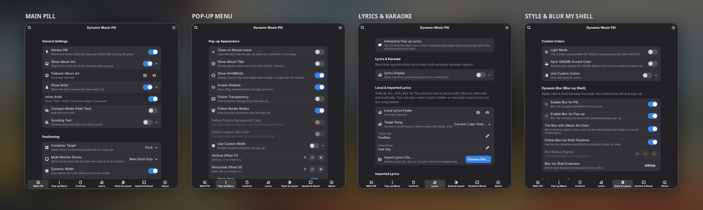
</p>

<details>
<summary><b>Tab 1 — Main Pill</b> (General display, positioning & per-mode sizing)</summary>

<p align="center">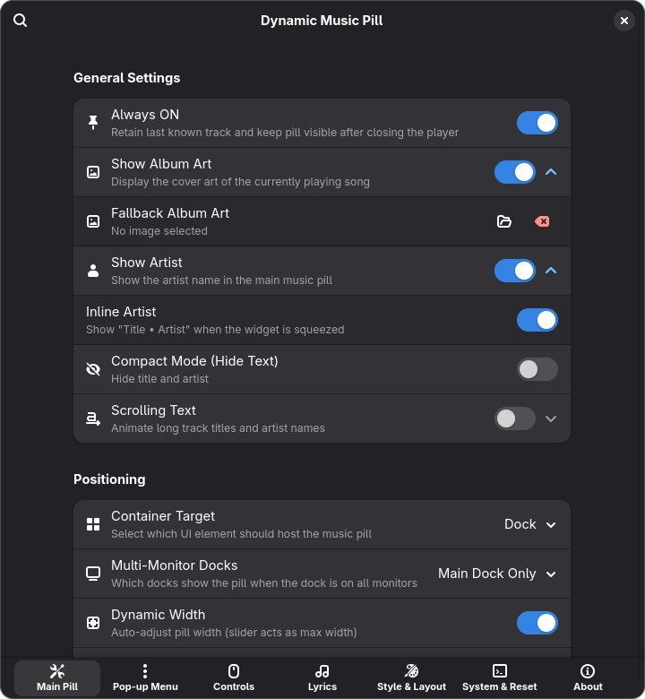</p>

| Setting | Description |
|---|---|
| Always ON | Retains the last known track and keeps the pill visible after the media player is closed. |
| Show Album Art | Displays the cover art thumbnail inside the pill. |
| Fallback Album Art | Sets a custom PNG or JPEG image when the current track provides no cover art. |
| Show Artist / Inline Artist | Displays the artist line or switches to `"Title • Artist"` when narrow. |
| Compact Mode (Hide Text) | Hides title and artist text for a minimal cover + visualizer pill. |
| Scrolling Text | Smoothly scrolls long titles/artists (with optional hover-only & freeze-on-pause). |
| Container Target | Hosts the pill in **Dock**, **Panel Left**, **Panel Center**, or **Panel Right**. |
| Multi-Monitor Docks | Choose between Main Dock Only, All Docks, or Secondary Docks Only. |
| Dynamic Width / Alignment / Offsets | Auto-fits width up to cap, sets alignment/manual index, and tunes X/Y offsets & dimensions separately for Dock and Panel modes. |

</details>

<details>
<summary><b>Tab 2 — Pop-up Menu</b> (Vinyl art, custom buttons, player selector & pop-up visualizer)</summary>

<p align="center">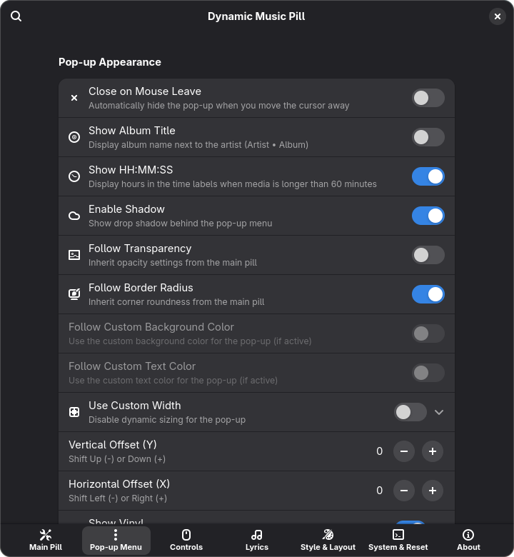</p>

| Setting | Description |
|---|---|
| Close on Mouse Leave | Auto-hides the pop-up when the cursor moves outside it. |
| Show Album Title / HH:MM:SS | Optionally append album name after artist and display hours for long tracks. |
| Enable Shadow & Inheritance | Toggle pop-up shadow and independently inherit transparency, border radius, and custom colors. |
| Show / Rotate / Square Vinyl | Display circular rotating vinyl disc (adjustable speed) or static rounded square cover. |
| Shuffle & Repeat Controls | Toggle shuffle and repeat loop buttons inside the pop-up bar. |
| Custom Control Buttons (Slot 1 & 2) | Bind two extra pop-up buttons to **Volume**, **Audio Output**, **Sleep Timer**, **Playback Speed**, **Recently Played**, or **Seek Step**. |
| Player Selector | Displays active MPRIS players cleanly at the top of the pop-up (optional Auto selector toggle). |
| Pop-up Visualizer | Independent bar count (`2–64`), width (`1–20 px`), height, and option to hide the main pill visualizer while open. |

</details>

<details>
<summary><b>Tab 3 — Controls</b> (Mouse bindings, hover delay, touchpad/wheel scroll & tablet overlay)</summary>

<p align="center">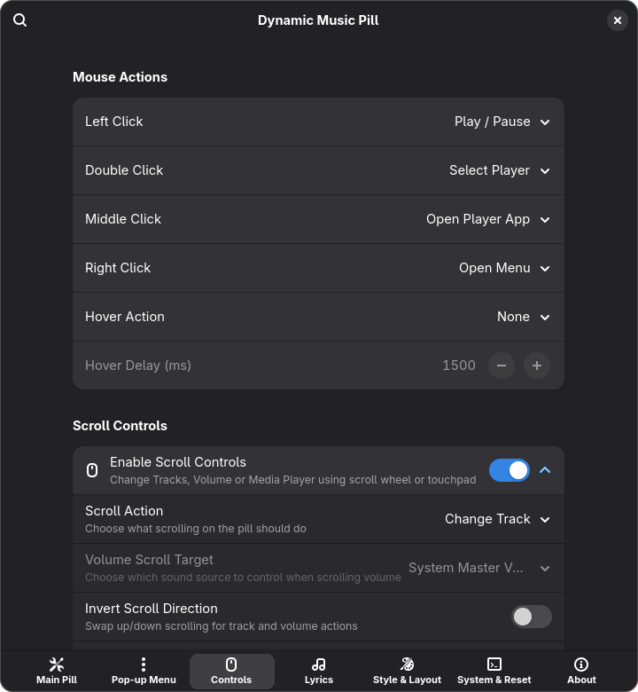</p>

| Setting | Description |
|---|---|
| Mouse & Hover Actions | Map **Left Click**, **Double Click**, **Middle Click**, **Right Click**, and **Hover** (`0–3000 ms` delay) independently. |
| Scroll Controls | Enable scrolling on the pill to **Change Track**, **Change Volume**, or **Switch Player**. |
| Volume Scroll Target | Choose **System Master Volume** or **Active Player Application** volume. |
| Invert Animation / Direction | Independently invert the scroll jump animation and scroll wheel/touchpad direction. |
| Tablet Mode Controls | Overlay **Skip Only**, **Play/Pause Only**, or **All Controls** directly on the pill. |

</details>

<details>
<summary><b>Tab 4 — Lyrics</b> (Synced karaoke display, script preference & local `.lrc`/`.ttml` import)</summary>

<p align="center">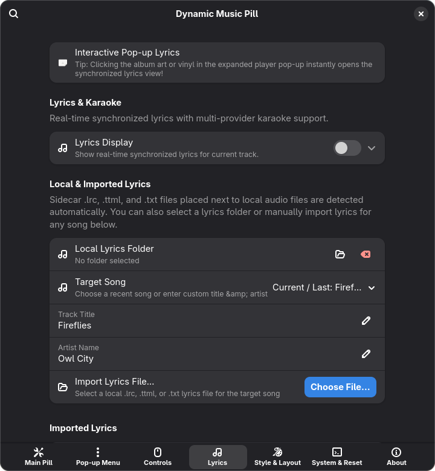</p>

| Setting | Description |
|---|---|
| Lyrics Display & Fade | Toggle live synchronized lyrics and configure line transition duration (`50–2000 ms`). |
| Word-Level Karaoke | Enable per-word karaoke highlight progression directly on the pill and pop-up. |
| Preferred Script | Choose **Auto**, **Prefer Original Script (CJK/Hangul)**, or **Prefer Latin / Romanized**. |
| Local Lyrics Folder | Point to a folder of `.lrc`, `.ttml`, or `.txt` files for automatic offline lookup. |
| Manual Lyrics Import | Attach a local `.lrc`, `.ttml`, or `.txt` file to the currently playing track or any custom title/artist. |

</details>

<details>
<summary><b>Tab 5 — Style & Layout</b> (Audio visualizer, Blur my Shell pipelines, colors & transparency)</summary>

<p align="center">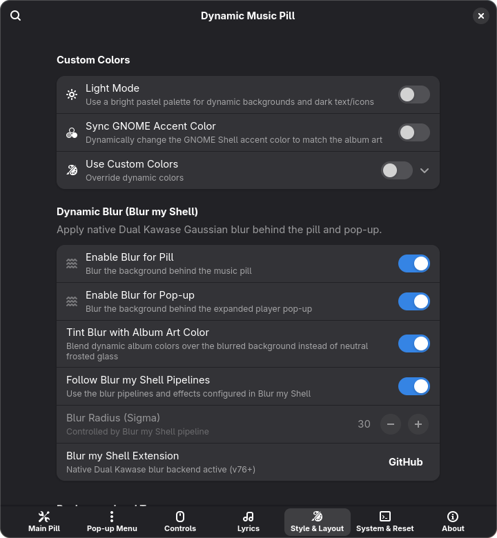</p>

| Setting | Description |
|---|---|
| Visualizer Style & Dimensions | **Off**, **Wave**, **Beat**, or **Real-Time (`cava`)**, plus bar count, bar width, height, and margin. |
| Dynamic Blur (`Blur my Shell`) | Enable blur behind Pill and Pop-up, tint blur with album art, or follow your `Blur my Shell` Dual Kawase / Liquid pipelines. |
| Colors & Light Mode | **Light Mode**, **Sync GNOME Accent Color**, or custom background, text, and visualizer color overrides. |
| Per-Layer Transparency & Outline | Global opacity slider plus independent transparency switches for art, text, and visualizer, outline border, and drop shadow. |

</details>

<details>
<summary><b>Tab 6 — System & Reset</b> (Game Mode, player filtering, App ID mapping & JSON backup)</summary>

<p align="center">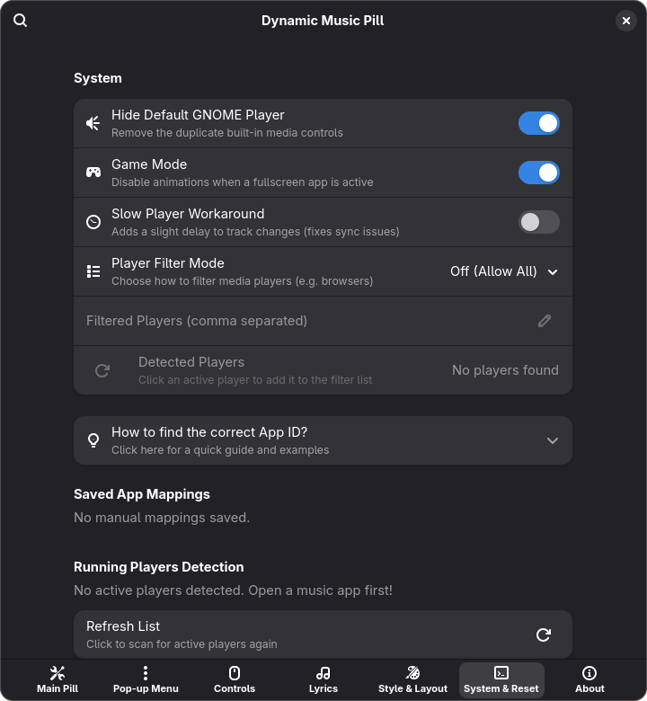</p>

| Setting | Description |
|---|---|
| Hide Default GNOME Player | Removes the duplicate built-in media controls from GNOME Quick Settings. |
| Game Mode & Slow Player Fix | Auto-pauses animations in fullscreen apps, and optional compatibility delay for slower MPRIS players. |
| Player Filter & App ID Mapping | Live D-Bus player detection to Whitelist/Blacklist players or pair custom MPRIS names to `.desktop` App IDs. |
| Export / Import / Reset | Serialize full preferences to `.json`, restore backups, or reset to defaults. |

</details>

<details>
<summary><b>Tab 7 — About</b> (Version changelog, Weblate status & project links)</summary>

<p align="center">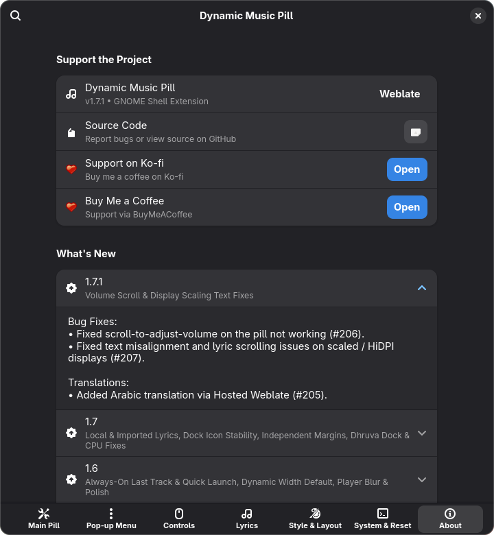</p>

</details>

---

## Contributors

Dynamic Music Pill is built by **András László ([@Andbal23](https://github.com/Andbal23))** together with community code contributors and translators worldwide!

<p align="center">
  <a href="https://github.com/Andbal23/dynamic-music-pill/graphs/contributors">
    
  </a>
</p>

### Translations ([Hosted Weblate](https://hosted.weblate.org/engage/dynamic-music-pill/))

<div align="center">
  <a href="https://hosted.weblate.org/engage/dynamic-music-pill/">
    
  </a>
</div>

- **Arabic**: Issam Khalaf
- **Chinese (Simplified)**: LuceLoong, O2bmm
- **Dutch**: Heimen Stoffels, László András
- **French**: Ocin4ever, elmagio, lebao3105
- **German**: Christian Lauinger
- **Hindi**: Dhananjay Porwal
- **Hungarian**: László András
- **Indonesian**: Arif Budiman, Joy, RafifSakti
- **Italian**: albanobattistella, talpinum, gio
- **Japanese**: penne
- **Portuguese**: ssantos
- **Portuguese (Brazil)**: Guilherme Odai, [@silveirajhess-cyber](https://github.com/silveirajhess-cyber)
- **Russian**: Daniel Freak, slytheduck
- **Spanish**: [@champinondev-lab](https://github.com/champinondev-lab), Elsie, yael
- **Swedish**: Andreas Rheindorf, László András
- **Tamil**: [@tamilneram247](https://github.com/tamilneram247)
- **Turkish**: Yiğithan Karabel, Buğra Çağlar
- **Ukrainian**: Олег Попов, László András
- **Vietnamese**: Huynh Tuan Dung, lebao3105

---

## Support & More Extensions

<div align="center">

[](https://www.buymeacoffee.com/andbal)
[](https://ko-fi.com/andbal)

Check out more GNOME extensions: **[Extension Profiles](https://github.com/Andbal23/extension-profiles)** · **[Timed Do Not Disturb](https://github.com/Andbal23/timed-do-not-disturb)**

</div>

## Star History

[](https://star-history.com/#Andbal23/dynamic-music-pill&Date)

---

## License

This project is licensed under the [GPL-3.0 License](LICENSE).

<p align="center">Made with ❤️ for the GNOME community.</p>
